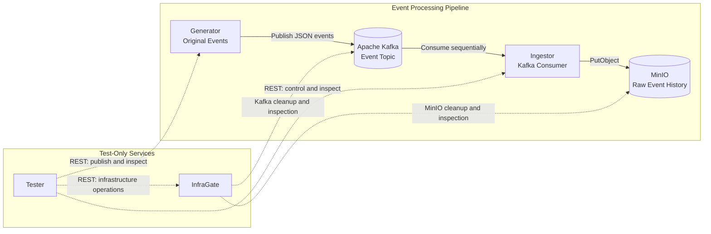
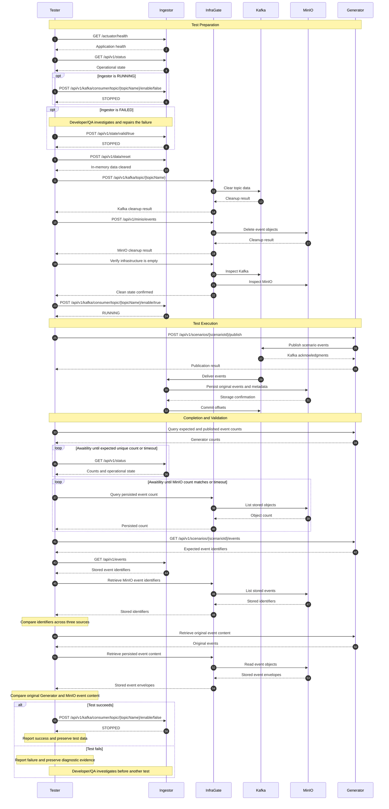

# CommerceETLAV Ingestor

[← Back to CommerceETLAV Main README](https://github.com/orbartal/commerce-etlav-manager/blob/main/README.md)

## Overview

**CommerceETLAV Ingestor** (`commerce-etlav-ingestor`) is a microservice in the [CommerceETLAV](https://github.com/orbartal/commerce-etlav-manager) project.  \
CommerceETLAV demonstrates Big Data, ETL, streaming, analytics, and AI/ML using a microservice architecture. \
Ingestor belongs to the CommerceETLAV event-streaming flow: Generator -> Kafka -> Ingestor -> MinIO.

Ingestor consumes commerce events from Apache Kafka, add to each event its metadata, and persists events in MinIO to be used by other services. \
Ingestor consume from Kafka and write to MinIO but also exposes Ingestor Rest APIs for operational control, monitoring, and testing. \
MVP prioritizes deterministic behavior, reproducible tests, simple services and clear failure investigation. Later versions will add scale and resilience.

## Table of Contents

- [1. Context and Goals](#1-context-and-goals)
- [2. Scenario and Event Model](#2-scenario-and-event-model)
- [3. Ingestor Architecture](#3-ingestor-architecture)
- [4. Technology Stack](#4-technology-stack)
- [5. MVP Scope and Limitations](#5-mvp-scope-and-limitations)
- [6. Event Processing](#6-event-processing)
- [7. State Management](#7-state-management)
- [8. Ingestor API](#8-ingestor-api)
- [9. Errors and Tracing](#9-errors-and-tracing)
- [10. Ingestor Configuration](#10-ingestor-configuration)
- [11. Testing and Cleanup](#11-testing-and-cleanup)
- [12. Development and Deployment](#12-development-and-deployment)
- [13. Future Extensions and References](#13-future-extensions-and-references)

---

## 1. Context and Goals

### CommerceETLAV Context

CommerceETLAV is a proof-of-concept project designed to demonstrate Big Data, distributed systems, event streaming, ETL, analytics, and AI/ML.  \
The project simulates an analytics platform receiving commerce events from a fictional retailer. \
In production, commerce events would originate from external business systems rather than Generator.  \
Ingestor is responsible for the boundary between event transport and raw event storage.

The initial event-streaming pipeline is:

```text
Generator → Kafka → Ingestor → MinIO
```

Each component has a separate responsibility:

| Component | Responsibility |
|---|---|
| Generator | Generates predefined commerce scenarios and publishes events |
| Kafka | Transports events between services |
| Ingestor | Consumes events and persists their raw history |
| MinIO | Stores persisted events for downstream processing |
| Tester | Orchestrates and validates end-to-end tests |
| InfraGate | Provides test-only REST access to infrastructure |

### Ingestor Goals

Ingestor must:

1. Consume original commerce events from a configurable Kafka topic.
2. Preserve the complete original event JSON without modification.
3. Add technical ingestion and storage timestamps.
4. Persist events in MinIO using deterministic object keys.
5. Preserve the history of unique source events.
6. Commit Kafka offsets only after successful persistence.
7. Detect duplicate event UUIDs during the current process lifetime.
8. Expose operational state, counters, and successfully stored event identifiers.
9. Support explicit consumer control and test-data reset through REST APIs.
10. Provide clear errors and tracing for failure investigation.

### Non-Responsibilities

Ingestor does not:

- Generate commerce events.
- Define or manage scenarios.
- Reconstruct current business entities or business state.
- Perform business analytics or transformations.
- Validate complete commerce business workflows.
- Manage Kafka or MinIO infrastructure cleanup.
- Determine when a scenario has finished.
- Automatically repair failed processing.
- Coordinate end-to-end tests.

These responsibilities belong to other CommerceETLAV services.

---

## 2. Scenario and Event Model

Ingestor receives events generated upstream by Generator.   \
A developer need to know the overall CommerceETLAV architecture but not every microservice details inorder to understand this contracts. \
For the complete Generator specification, see the [Generator README](https://github.com/orbartal/commerce-etlav-generator/blob/main/README.md).

### Scenario Model

A scenario represents a predefined, reproducible sequence of commerce events.

Each scenario has:

- An immutable scenario UUID.
- A unique name and description.
- One predefined dataset UUID.
- A predefined sequence of events.
- Deterministic original event content.

Generator stores scenarios and their original events in PostgreSQL. \
Generator publishes the original events to Kafka in their predefined order. \
Ingestor does not receive or manage scenario definitions.

### Event Model

The initial commerce event types are:

1. `SESSION_START`
2. `ORDER_CREATED`
3. `ORDER_ITEM_ADDED`
4. `ORDER_SUBMITTED`
5. `PURCHASE`
6. `DELIVERED`
7. `SESSION_END`

Each event contains:

- `eventId`: Immutable event UUID.
- `datasetId`: UUID identifying the dataset.
- Event type.
- Original business data.
- Original event timestamps.
- Event sequence information.

The exact event JSON structure is defined by the shared 
[CommerceETLAV Event Model](https://github.com/orbartal/commerce-etlav-manager/blob/main/docs/events.md). \
Ingestor treats business-specific fields as opaque data. \
It validates only the technical identifiers required for ingestion.

### Event Identity

The event UUID identifies an original source event. \
The dataset UUID identifies the dataset to which that event belongs. \
The same event may be delivered more than once by Kafka. \
Repeated delivery does not create a new original event.

For storage and in-memory tracking, Ingestor uses the pair:

```text
(datasetId, eventId)
```


### Event Ordering

Generator publishes events sequentially in scenario order.

For MVP:

- Kafka uses one topic partition.
- Ingestor uses one consumer.
- Ingestor processes one event at a time.
- Kafka offsets are committed sequentially.

This preserves consumption order within the single Kafka partition. \
Ingestor does not independently validate business event sequence continuity. \
Future versions may support multiple partitions, consumers, and datasets.

### Scenario Isolation

Ingestor has no concept of scenario execution.

It does not know:

- Which scenario Tester is currently running.
- How many events belong to that scenario.
- Whether all scenario events have been published.
- Whether the next Kafka event belongs to a new scenario.

Although an event contains `datasetId`, Ingestor cannot inspect that value before consuming the event. \
Therefore, Ingestor cannot independently prevent events from different test scenarios from being mixed. \
**Tester is responsible for scenario isolation and test lifecycle coordination.** \
For MVP, only one test runs at a time.

---

## 3. Ingestor Architecture

### Architecture Diagram



Solid arrows represent the event-processing pipeline. \
Dashed arrows represent test-only REST or infrastructure operations. \
InfraGate is not part of the production event-processing pipeline.

### Internal Components

Ingestor contains the following logical components:

| Component | Responsibility |
|---|---|
| Kafka Consumer | Receives Kafka messages and manages offsets |
| Event Processor | Validates technical identifiers and coordinates persistence |
| Event Storage | Persists event envelopes in MinIO |
| Operational State | Maintains consumer enablement and validity |
| Event Registry | Tracks successfully stored event identifiers in memory |
| Statistics | Maintains process-lifetime event counters |
| REST Controller | Exposes control, status, and inspection APIs |
| Error and Tracing | Produces structured errors and diagnostic logs |

These are logical responsibilities, not a requirement to create a separate Java class for every row.

### Kafka Integration

Ingestor subscribes to a configurable Kafka topic.

MVP defaults:

| Property | Value |
|---|---|
| Kafka topic | `stores.commerce.events` |
| Consumer group | `commerce-etlav-ingestor` |
| Topic partitions | 1 |
| Active consumers | 1 |
| Processing concurrency | 1 |
| Offset commits | Manual, after successful storage |

The Kafka message contains:

- Key: `datasetId` UUID.
- Value: Complete original Generator event JSON.

The Kafka topic and consumer group are independently configurable.

### MinIO Integration

Ingestor stores events using the S3-compatible API provided by MinIO.

MVP default bucket:

```text
stores.commerce.events
```

The bucket name and Kafka topic name happen to share the same default value. \
They are independent configuration properties. \
Ingestor uses the AWS SDK for Java v2 S3 client rather than a MinIO-specific SDK.

### Storage Abstraction

MinIO access must be isolated behind a small storage abstraction. \
The event-processing logic should not depend directly on S3 SDK operations. \
For MVP, the storage abstraction only needs to support writing event objects. \
This allows a future storage implementation to replace MinIO without changing the event-processing workflow.

### Persistence Boundaries

Ingestor maintains two different forms of data:

**Persistent event history**

Stored in MinIO.

Contains original events and ingestion metadata.

**Transient operational data**

Stored in Ingestor memory.  \
Contains event identifiers, counters, timestamps, and operational state.  \
Ingestor does not use an additional database in MVP.

---

## 4. Technology Stack

| Component | Technology |
|---|---|
| Programming language | Java 27 |
| Application framework | Spring Boot 4 |
| Build system | Maven 3 |
| Kafka integration | Spring Kafka |
| Object storage integration | AWS SDK for Java v2 — S3 |
| REST API | Spring MVC |
| Application health | Spring Boot Actuator |
| Event transport | Apache Kafka |
| Object storage | MinIO |
| Containerization | Docker |
| Local orchestration | Docker Compose |

### Technology Principles

- Prefer standard, established libraries.
- Keep the implementation small and understandable.
- Use synchronous event processing for MVP.
- Avoid unnecessary concurrency and background workers.
- Avoid additional databases and queues.
- Separate infrastructure integration from processing logic.
- Favor deterministic behavior and diagnostics over throughput.
- Preserve a clear path to more scalable implementations.

Tester uses Awaitility for asynchronous validation.

Awaitility is a Tester dependency, not an Ingestor dependency.

---

## 5. MVP Scope and Limitations

CommerceETLAV is initially developed by one engineer over approximately two weeks. \
The objective is a working, demonstrable end-to-end event-processing pipeline. \
MVP is not intended to provide production-grade throughput, resilience, or multi-tenant isolation.

### MVP Scope

| Capability | MVP | Future / Production |
|---|---|---|
| Kafka topic | One configured topic | Multiple topics |
| Kafka partitions | One | Multiple |
| Kafka consumers | One | Consumer groups with parallel processing |
| Event processing | Sequential, synchronous | Parallel and asynchronous |
| Dataset processing | One active test dataset | Multiple concurrent datasets |
| Scenario awareness | None | Optional test-aware isolation |
| Event persistence | MinIO object storage | Scalable object storage architecture |
| Original event payload | Preserved unchanged | Preserved unchanged |
| Ingestion metadata | Basic timestamps | Extended metadata |
| Duplicate detection | In-memory event identifiers | Persistent, scalable deduplication |
| Event identifier API | Complete in-memory collection | Pagination and persistent lookup |
| Operational state | Three states | Richer lifecycle model |
| Consumer control | Explicit REST API | Automated orchestration where appropriate |
| Offset management | Manual sequential commits | Scalable offset and recovery management |
| Error handling | Fail-fast | Retries, recovery, and dead-letter handling |
| Process restart recovery | Not supported | Persistent recovery state |
| Test execution | One test at a time | Concurrent tests |
| Data isolation | Tester-controlled cleanup | Dataset/test isolation |
| Authentication | Not required locally | Authentication and authorization |
| Logging | Structured diagnostic logs | Centralized log collection and observability |
| Deployment | Local Docker Compose | Distributed production deployment |

### MVP Constraints

The initial implementation should support approximately 1,000 events per test. \
The design should remain extensible toward larger datasets, including millions or billions of events, without implementing that complexity in MVP. \

MVP intentionally excludes:

- Distributed transactions.
- Exactly-once end-to-end processing guarantees.
- Automatic process recovery.
- Automatic retries and dead-letter queues.
- Persistent operational counters.
- Persistent deduplication state.
- Multiple concurrent scenarios.
- Business state reconstruction.
- Production authentication and authorization.

### Failure Philosophy

MVP prioritizes preserving evidence over automatic recovery.

When an unexpected processing error occurs:

1. Stop processing.
2. Mark Ingestor invalid.
3. Preserve available state and data.
4. Report diagnostic information.
5. Require developer/QA investigation.

The system must not silently discard failures or automatically hide them through recovery.

---

## 6. Event Processing

### Normal Processing Flow

Ingestor processes one Kafka event at a time.

The normal flow is:

1. Receive the Kafka message.
2. Validate required technical identifiers.
3. Record the ingestion timestamp.
4. Construct the storage envelope and object key.
5. Write the object to MinIO and await confirmation.
6. Commit the Kafka offset.
7. Update operational statistics and emit diagnostic logs.

The event-processing workflow is synchronous.

The next event must not be processed before the current event finishes successfully.

### 6.1 Receive Event

Ingestor receives:

- Kafka message key.
- Original event JSON.
- Kafka topic.
- Kafka partition.
- Kafka offset.

The Kafka message key is the dataset UUID.

Ingestor does not modify the original event JSON.

### 6.2 Validate Identifiers

Ingestor validates:

- The event contains a valid `eventId` UUID.
- The event contains a valid `datasetId` UUID.
- The Kafka message key matches the event's `datasetId`.

Invalid technical identifiers cause processing failure.

Ingestor does not validate commerce business rules.

### 6.3 Ingestion Timestamp

`ingestedAt` records when Ingestor receives the event for processing.

It is a technical timestamp generated by Ingestor.

It is independent of the original business event timestamps.

### 6.4 MinIO Object Key

Each original event is stored under:

```text
{datasetId}/{eventId}.json
```

For example:

```text
550e8400-e29b-41d4-a716-446655440000/a7f00000-0000-4000-8000-000000000001.json
```

The key is deterministic.

Repeated delivery of the same event writes to the same object key.

### 6.5 Storage Envelope

MinIO stores a JSON envelope containing the complete original event and technical metadata.

The envelope has the following structure:

```json
{
  "event": {
    "eventId": "a7f00000-0000-4000-8000-000000000001",
    "datasetId": "550e8400-e29b-41d4-a716-446655440000"
  },
  "metadata": {
    "ingestedAt": "2026-10-19T14:00:00Z",
    "storedAt": "2026-10-19T14:00:01Z"
  }
}
```

The `event` object above is abbreviated for illustration.

In actual storage, it contains the **entire original Generator event JSON**, including all original business fields, timestamps, and sequence information.

The original event must remain unchanged.

### 6.6 Storage Timestamps

The two metadata timestamps have different meanings.

| Field | Meaning |
|---|---|
| `ingestedAt` | Time Ingestor received the event for processing |
| `storedAt` | Time immediately before initiating the MinIO write |

`storedAt` is not the exact time MinIO confirmed persistence.

This definition avoids requiring a second MinIO write after confirmation.

Both timestamps should use UTC ISO 8601 representation.

### 6.7 Persist Event

Ingestor writes the envelope using the S3 `PutObject` operation.

Requirements:

- Use the configured MinIO bucket.
- Use the deterministic object key.
- Set content type to `application/json`.
- Wait for successful completion.
- Treat unsuccessful or uncertain persistence as an error.

Ingestor must not commit the Kafka offset before successful storage confirmation.

### 6.8 Commit Kafka Offset

After MinIO confirms the write, Ingestor commits the corresponding Kafka offset. \
Manual offset management is required. \
Automatic Kafka offset commits must be disabled. \
A commit failure is an ingestion failure, even when the MinIO object was successfully written. \
The persisted object must remain available for investigation.

### 6.9 Update Statistics

After successful storage, Ingestor updates its in-memory event registry and counters. \
The event registry tracks unique successfully stored `(datasetId, eventId)` pairs. \
The successful-event registry is updated only after MinIO confirms persistence. \
A later Kafka offset commit failure does not undo a successful MinIO write.

Counters distinguish:

- Received Kafka deliveries.
- Successful MinIO writes.
- Unique successfully stored events.
- Failed processing attempts.


### 6.10 Duplicate Events

A duplicate is another Kafka delivery with an already successfully stored `(datasetId, eventId)` pair.

For MVP:

- Detect duplicates using the in-memory event registry.
- Log duplicates at WARN level.
- Do not fail processing solely because of duplication.
- Write the event to the same MinIO object key.
- Allow the existing object to be overwritten.
- Commit the Kafka offset after successful storage.
- Count the delivery and successful write.
- Do not increment the unique-event count.

The original event payload remains unchanged. \
The ingestion metadata may change when a duplicate overwrites the object. \
Duplicate detection applies only within the current process lifetime. \
Ingestor does not perform a MinIO lookup to detect duplicates.

### 6.11 Processing Failure

Any unexpected failure during validation, persistence, or offset commit causes Ingestor to:

1. Record the failure.
2. Update failure statistics.
3. Log diagnostic information.
4. Disable Kafka consumption.
5. Mark operational validity as invalid.
6. Enter `FAILED`.

No automatic retry, dead-letter queue, or recovery mechanism is required in MVP.

---

## 7. State Management

Ingestor has an explicit operational state model.

Its lifecycle state is derived from two binary properties:

1. Consumer enablement.
2. Operational validity.

Event collection emptiness is an independent property.

### 7.1 State Properties

| Property | Values | Meaning |
|---|---|---|
| Consumer | Enabled / Disabled | Whether Kafka consumption is enabled |
| Events | Empty / Non-empty | Whether the in-memory successful-event registry contains entries |
| Validity | Valid / Invalid | Whether Ingestor is operationally certified for use |

### 7.2 Operational States

| State | Consumer | Events | Validity |
|---|---|---|---|
| `STOPPED` | Disabled | Empty / Non-empty | Valid |
| `RUNNING` | Enabled | Empty / Non-empty | Valid |
| `FAILED` | Disabled | Empty / Non-empty | Invalid |

The fourth possible combination, Enabled + Invalid, is prohibited.

Events do not determine the operational state.

### 7.3 Initial State

After successful application initialization:

- Consumer is disabled.
- Validity is valid.
- Event registry is empty.
- Counters are initialized.
- Operational state is `STOPPED`.

Ingestor must not automatically start consuming Kafka events. \
Consumption begins only after an explicit REST API request.

### 7.4 Valid State Transitions

| From | To | Trigger |
|---|---|---|
| `STOPPED` | `RUNNING` | Enable consumer API |
| `RUNNING` | `STOPPED` | Disable consumer API |
| `RUNNING` | `FAILED` | Automatic processing failure |
| `STOPPED` | `FAILED` | Developer/QA marks validity invalid |
| `FAILED` | `STOPPED` | Developer/QA marks validity valid |
| `STOPPED` | `STOPPED` | Data reset |

The consumer-disable operation must reject requests while an event is actively being processed.  \
A successful disable operation stops future Kafka consumption.

### 7.5 Invalid Operations

| Current State | Operation | Reason |
|---|---|---|
| `RUNNING` | Enable consumer | Already enabled |
| `RUNNING` | Disable during active processing | Cannot interrupt an in-flight event |
| `RUNNING` | Reset data | Consumer must be stopped |
| `RUNNING` | Set validity invalid through API | Consumer must be disabled first |
| `FAILED` | Enable consumer | Invalid state cannot consume |
| `FAILED` | Reset data | Invalid state must be manually certified first |
| `STOPPED` | Disable consumer | Already disabled |

Invalid operations must raise dedicated application exceptions. \
Rejected operations must not modify the operational state.

### 7.6 Validity Certificate

Validity is a human-controlled operational certification. \
It is **not** a deterministic health check. \
A valid state means that a developer or QA engineer has accepted responsibility for considering Ingestor ready for use. \
Ingestor may automatically change validity from valid to invalid when processing fails. \
Ingestor must never automatically restore validity from invalid to valid.

Only an explicit call to:

```text
POST /api/v1/state/valid/true
```

may restore validity.

This call:

- Changes the validity flag.
- Does not repair infrastructure.
- Does not restart consumption.
- Does not reset data.
- Does not verify persisted events.
- Does not automatically resolve the original failure.

The developer/QA engineer must investigate and resolve the issue before making this call.

### 7.7 Application Health vs Operational Status

Ingestor exposes two different health-related APIs.

**Application health**

```text
GET /actuator/health
```

Answers whether the Spring Boot application is running and healthy.

**Operational status**

```text
GET /api/v1/status
```

Answers whether Ingestor is operationally valid, whether its consumer is enabled, and what events it has processed. \
An application may be healthy while Ingestor is operationally `FAILED`. \
These are different conditions, not contradictory results. \
Both APIs should be used by Tester.

---

## 8. Ingestor API

Ingestor exposes exactly nine REST endpoints in MVP:

- Three POST endpoints for modifying operational properties.
- Three corresponding GET endpoints for reading those properties.
- Three additional GET endpoints for status, events, and application health.

### 8.1 Endpoint Summary

| Method | Endpoint | Responsibility |
|---|---|---|
| POST | `/api/v1/kafka/consumer/topic/{topicName}/enable/{isEnable}` | Enable or disable Kafka consumption |
| GET | `/api/v1/kafka/consumer/topic/{topicName}/enable` | Read consumer enablement |
| POST | `/api/v1/data/reset` | Clear in-memory test data |
| GET | `/api/v1/data/empty` | Check whether event data is empty |
| POST | `/api/v1/state/valid/{isValid}` | Modify validity certification |
| GET | `/api/v1/state/valid` | Read validity certification |
| GET | `/api/v1/status` | Read operational state and statistics |
| GET | `/api/v1/events` | List successfully stored event identifiers |
| GET | `/actuator/health` | Read Spring Boot application health |

### 8.2 Consumer Enablement

**Modify**

```text
POST /api/v1/kafka/consumer/topic/{topicName}/enable/{isEnable}
```

Parameters:

| Parameter | Type | Meaning |
|---|---|---|
| `topicName` | String | Configured Kafka topic |
| `isEnable` | Boolean | Requested consumer enablement |

The topic name must match Ingestor's configured topic.

MVP supports only one configured topic.

**Enable (`true`)**

Preconditions:

- Current state is `STOPPED`.
- Validity is valid.
- Consumer initialization is complete.

Result:

- Kafka consumption starts.
- State becomes `RUNNING`.

**Disable (`false`)**

Preconditions:

- Current state is `RUNNING`.
- No event is actively being processed.

Result:

- Kafka consumption stops.
- State becomes `STOPPED`.

The operation must fail rather than interrupt an event during MinIO persistence or Kafka offset commit.

**Read**

```text
GET /api/v1/kafka/consumer/topic/{topicName}/enable
```

Example response:

```json
{
  "topicName": "stores.commerce.events",
  "enabled": false
}
```

### 8.3 Data Reset

**Modify**

```text
POST /api/v1/data/reset
```

Precondition:

- Current state must be `STOPPED`.

The operation clears:

- In-memory successful-event registry.
- All four event counters.
- Last consumed timestamp.
- Last stored timestamp.
- Last error details.
- Other transient per-test processing metadata.

The operation does not:

- Change consumer enablement.
- Change validity.
- Delete Kafka records.
- Reset Kafka offsets.
- Delete MinIO objects.
- Delete Generator scenario data.

After a successful reset, Ingestor remains `STOPPED`.

A reset request from `RUNNING` or `FAILED` must throw a dedicated exception and leave the state unchanged.

**Read**

```text
GET /api/v1/data/empty
```

Example response:

```json
{
  "empty": true
}
```

The result describes the in-memory successful-event registry. \
It does not indicate whether Kafka or MinIO contains data.

### 8.4 Validity Certification

**Modify**

```text
POST /api/v1/state/valid/{isValid}
```

Parameters:

| Parameter | Type | Meaning |
|---|---|---|
| `isValid` | Boolean | Requested validity certification |

Precondition:

- Kafka consumer must be disabled.

**Set invalid (`false`)**

- Allowed from `STOPPED`.
- Changes validity to invalid.
- State becomes `FAILED`.

This supports manual invalidation when a developer discovers a problem through logs, event data, or investigation.

**Set valid (`true`)**

- Allowed from `FAILED`.
- Changes validity to valid.
- State becomes `STOPPED`.

This is a manual developer/QA certification. \
It does not perform recovery or validation automatically.

**Read**

```text
GET /api/v1/state/valid
```

Example response:

```json
{
  "valid": true
}
```

### 8.5 Operational Status

```text
GET /api/v1/status
```

Example response:

```json
{
  "status": "RUNNING",
  "consumerEnabled": true,
  "valid": true,
  "consumerGroup": "commerce-etlav-ingestor",
  "kafkaTopic": "stores.commerce.events",
  "minioBucket": "stores.commerce.events",
  "consumedEventCount": 100,
  "storedEventCount": 100,
  "uniqueEventCount": 100,
  "failedEventCount": 0,
  "lastConsumedAt": "2026-10-19T14:00:00Z",
  "lastStoredAt": "2026-10-19T14:00:01Z",
  "lastError": null
}
```

### Status Fields

| Field | Description |
|---|---|
| `status` | Derived state: `STOPPED`, `RUNNING`, or `FAILED` |
| `consumerEnabled` | Whether Kafka consumption is enabled |
| `valid` | Current validity certification |
| `consumerGroup` | Configured Kafka consumer group |
| `kafkaTopic` | Configured Kafka topic |
| `minioBucket` | Configured MinIO bucket |
| `consumedEventCount` | Total Kafka deliveries received |
| `storedEventCount` | Total successful MinIO writes |
| `uniqueEventCount` | Distinct successfully stored event identifiers |
| `failedEventCount` | Failed processing attempts |
| `lastConsumedAt` | Timestamp of most recently received event |
| `lastStoredAt` | Timestamp of most recent successful storage |
| `lastError` | Most recent processing error details |

Counters are maintained in memory. \
Duplicate deliveries may increase `consumedEventCount` and `storedEventCount` without increasing `uniqueEventCount`. \
The event counters and timestamps are reset through the data-reset API.

### 8.6 Successfully Stored Events

```text
GET /api/v1/events
```

Returns the unique event identifiers successfully stored by the current Ingestor process since the last reset.

Example response:

```json
{
  "eventIds": [
    {
      "eventId": "a7f00000-0000-4000-8000-000000000001",
      "datasetId": "550e8400-e29b-41d4-a716-446655440000"
    },
    {
      "eventId": "b8200000-0000-4000-8000-000000000002",
      "datasetId": "550e8400-e29b-41d4-a716-446655440000"
    }
  ],
  "count": 2
}
```

Each item contains:

- `eventId`
- `datasetId`

The response must not contain complete original event payloads. \
The `count` equals the number of returned unique identifiers.

For MVP:

- No pagination.
- No persistent event registry.
- No historical lookup after process restart.
- No event payload retrieval.

Future versions may add pagination and persistent event lookup.

### 8.7 Application Health

```text
GET /actuator/health
```

Uses Spring Boot Actuator.

Its responsibility is application health, not operational validity certification.

Tester should check this endpoint separately from `/api/v1/status`.

### 8.8 REST Error Responses

REST errors use the shared exception architecture described in Section 9.

Examples of rejected requests include:

- Enabling an already enabled consumer.
- Disabling a consumer during event processing.
- Enabling consumption while invalid.
- Resetting data outside `STOPPED`.
- Modifying validity while consumption is enabled.
- Using a Kafka topic different from the configured topic.
- Starting consumption before initialization completes.

Each distinct failure condition must have a distinct exception type.

---

## 9. Errors and Tracing

### 9.1 Error Handling Principles

Ingestor follows these principles:

- Fail fast on unexpected processing errors.
- Never silently discard events.
- Preserve diagnostic information.
- Do not automatically recover from processing failures.
- Use dedicated exception types for distinct failure conditions.
- Keep REST errors consistent with other CommerceETLAV microservices.

### 9.2 Exception Architecture

Ingestor follows the exception architecture established by Generator.

`IngestorException` extends `RuntimeException`.

Each exception contains:

- Human-readable message.
- Error type.
- Unique exception-instance UUID.
- Optional original cause.

`HttpIngestorException` extends `IngestorException` and additionally contains an HTTP status. \
An `ErrorType` interface is implemented by Java enums. \
Each error-type enum value identifies a unique exception factory location in the Java implementation. \
Exception factories construct application exceptions with consistent messages, types, causes, and HTTP statuses. \
Application components should use exception factories instead of constructing application exceptions directly.

### 9.3 Error Categories

The implementation must distinguish at least the following error conditions:

| Category | Example |
|---|---|
| Invalid event identifier | Missing or malformed `eventId` |
| Invalid dataset identifier | Missing or malformed `datasetId` |
| Kafka key mismatch | Message key differs from event dataset |
| MinIO persistence failure | Object write unsuccessful |
| Kafka offset commit failure | Offset cannot be committed |
| Consumer already enabled | Enable requested while running |
| Consumer already disabled | Disable requested while stopped |
| Consumer busy | Disable requested during active processing |
| Invalid operational state | Operation prohibited in current state |
| Invalid topic | API topic differs from configured topic |
| Consumer initialization failure | Consumer cannot be started |
| Invalid validity transition | Certification change violates state rules |
| Data reset rejected | Reset requested outside `STOPPED` |

Each distinct failure condition must have its own error type.

Exception class organization may group related conditions, but error types must remain distinguishable.

### 9.4 REST Error Contract

A centralized REST exception handler converts exceptions into consistent responses.

Example:

```json
{
  "requestId": "b5a62c2e-718e-49fa-88b4-faf8e2ab85f3",
  "status": "FAILED",
  "error": {
    "type": "DATA_RESET_INVALID_STATE",
    "instance": "ba8c7817-43e1-4e64-96a5-d82b7d339ed8",
    "message": "Data reset is allowed only when Ingestor is STOPPED."
  }
}
```

The request ID identifies the REST request. \
The exception instance identifies the individual error occurrence. \
Both must be available in logs. \
Internal stack traces must not be exposed to REST callers. \
Invalid lifecycle operations should normally return HTTP `409 Conflict`. \
Malformed request parameters should return an appropriate client-error status. \
Infrastructure and unexpected processing failures should use appropriate server-error statuses.

### 9.5 Processing Failures

When event processing fails:

1. Record the failed operation.
2. Increment the failed-event counter.
3. Preserve relevant event and infrastructure identifiers.
4. Emit an ERROR log.
5. Disable Kafka consumption.
6. Mark validity invalid.
7. Expose `FAILED` through the operational status API.

A processing failure must not automatically restore Ingestor to a valid state. \
If MinIO persistence succeeds but Kafka offset commit fails, the MinIO object remains stored. \
Ingestor must report the failure rather than treating the event as fully processed.

### 9.6 Duplicate Events

Duplicate deliveries are not considered fatal processing errors.

Ingestor:

- Detects duplicates within its in-memory registry.
- Emits a WARN log.
- Overwrites the existing MinIO object.
- Continues processing after successful persistence and offset commit.

Duplicate detection is not guaranteed after process restart.

### 9.7 Structured Logging

Ingestor produces structured diagnostic logs.

Event-processing logs should include relevant identifiers:

- Event UUID.
- Dataset UUID.
- Kafka topic.
- Kafka partition.
- Kafka offset.
- MinIO bucket.
- MinIO object key.
- Processing timestamps.
- Processing outcome.
- Exception type and instance when applicable.

Recommended log levels:

| Level | Usage |
|---|---|
| INFO | Normal lifecycle changes and successful event processing |
| WARN | Duplicate event delivery and recoverable abnormal conditions |
| ERROR | Processing failures, infrastructure failures, and invalidation |

### 9.8 Distributed Tracing

CommerceETLAV will define shared cross-project logging and tracing standards.

Each log record must support:

**Transaction ID**

Identifies an end-to-end operation spanning multiple microservices.

**Trigger ID**

Identifies the immediate cause of an operation within one microservice.

Examples include:

- REST request.
- Kafka event.
- Scheduled job.
- Initialization operation.

Transaction IDs and trigger IDs have different responsibilities. \
The shared standards will be defined separately in the Manager documentation. \
A future dedicated microservice may aggregate logs from multiple services. \
The MVP should retain sufficient identifiers for manual investigation without implementing a full distributed tracing platform.

### 9.9 Manual Recovery

After a processing failure, Ingestor remains `FAILED`.

A developer or QA engineer must:

1. Inspect Ingestor logs and status.
2. Inspect relevant Kafka and MinIO state.
3. Identify the failure cause.
4. Repair the underlying issue manually.
5. Decide whether the previous test can be repeated.
6. Explicitly restore Ingestor validity through REST API.
7. Prepare the next test through Tester.

The validity API is an acknowledgment of recovery, not the recovery operation itself.

---

## 10. Ingestor Configuration

Ingestor uses Spring Boot configuration properties and environment variables. \
Runtime configuration must not be hard-coded in Java.

### 10.1 Kafka Configuration

Required configurable properties include:

| Property | MVP Default |
|---|---|
| Kafka bootstrap servers | Environment-specific |
| Kafka topic | `stores.commerce.events` |
| Kafka consumer group | `commerce-etlav-ingestor` |
| Kafka offset auto-commit | Disabled |
| Kafka consumer concurrency | 1 |

Kafka topic and consumer group must be configured independently. \
The configured Kafka topic must match the topic used by Generator.

### 10.2 MinIO Configuration

Required configurable properties include:

| Property | MVP Default |
|---|---|
| MinIO endpoint | Environment-specific |
| MinIO bucket | `stores.commerce.events` |
| Access key | Environment-specific |
| Secret key | Environment-specific |
| Region | Environment-specific |
| Path-style access | Configurable |

MinIO credentials must not be committed to the repository. \
The configured bucket must exist and be accessible before ingestion begins. \
Ingestor requires permission to write event objects. \
The MVP does not require MinIO object listing or reading for duplicate detection.

### 10.3 REST Configuration

Configuration includes:

- Spring Boot server port.
- Actuator health endpoint exposure.
- Logging levels.
- REST error-handling configuration where required.

### 10.4 Consumer Configuration

Ingestor must start with Kafka consumption disabled. \
The consumer must not automatically begin processing when the Spring Boot application starts. \
Only the consumer-enable REST API may start normal consumption. \
The application must validate required configuration before accepting consumer-start requests.

### 10.5 Storage Configuration

The MinIO bucket name is independent of the Kafka topic name.

The object key format is:

```text
{datasetId}/{eventId}.json
```

The JSON envelope contains:

- `event`
- `metadata.ingestedAt`
- `metadata.storedAt`

### 10.6 Test Configuration

Tester, not Ingestor, owns asynchronous validation settings.

Tester uses Awaitility with configurable Spring Boot properties for:

- Initial polling delay.
- Polling interval.
- Maximum timeout.

Proposed initial defaults:

| Property | Default |
|---|---|
| Initial polling delay | 0 ms |
| Polling interval | 500 ms |
| Maximum timeout | 30 seconds |

These settings belong to Tester configuration and are documented here only as an integration contract.

### 10.7 Startup Validation

On application startup, Ingestor must validate required local configuration. \
Invalid required configuration should cause initialization failure. \
Successful startup leaves Ingestor in `STOPPED`. \
The consumer-start operation must verify that the required consumer initialization is complete.

---

## 11. Testing and Cleanup

Ingestor is validated through the external `commerce-etlav-tester` microservice.

Tester orchestrates the complete test lifecycle.

### 11.1 Test Service Responsibilities

**Tester**

- Coordinates test preparation and execution.
- Calls CommerceETLAV microservices through REST APIs.
- Controls Ingestor operational state.
- Triggers Generator scenarios.
- Validates event counts, identifiers, and original event content.
- Reports test results.
- Preserves failed-test evidence.

**InfraGate**

Repository:

```text
commerce-etlav-infra-gateway
```

Short name:

```text
InfraGate
```

InfraGate is a test-only helper microservice.

It hides infrastructure-specific APIs behind controlled REST endpoints.

For MVP, it communicates directly with:

- Kafka.
- MinIO.

InfraGate provides infrastructure cleanup, inspection, and event retrieval operations. \
It is not part of the production event-processing pipeline. \
Other production microservices communicate directly with infrastructure.

### 11.2 Test Isolation

MVP supports one test at a time.

Tester must ensure:

- Ingestor is not consuming during cleanup.
- Ingestor's in-memory event registry is cleared.
- Kafka transient event data is cleared.
- MinIO transient event data is cleared.
- Generator's persistent scenario data is preserved.
- The next test starts from a known clean state.

Ingestor does not independently validate scenario boundaries.

### 11.3 Test Preparation

Tester prepares the pipeline using the following sequence:

1. Check Ingestor application health.
2. Inspect Ingestor operational status.
3. Disable Ingestor's Kafka consumer if it is running.
4. If Ingestor is `FAILED`, require developer/QA investigation and manual recovery.
5. Restore validity through the Ingestor API only after recovery is approved.
6. Reset Ingestor's in-memory event data.
7. Request InfraGate to clean Kafka event data.
8. Request InfraGate to clean MinIO event data.
9. Verify the infrastructure is clean.
10. Enable Ingestor's Kafka consumer.
11. Trigger Generator scenario publication.

Kafka cleanup must leave the configured topic and consumer group in a state suitable for the next test.

The exact Kafka cleanup mechanism belongs to InfraGate's design.

### 11.4 Test Lifecycle Sequence Diagram



The diagram describes the logical test workflow. \
InfraGate's detailed read-only API paths will be finalized in its own design.

### 11.5 Completion Checks

Tester validates the pipeline in six logical stages.

**Stage 1 — Expected Events**

Ask Generator for the selected scenario and its expected event count.

The scenario must be ready for publication.

**Stage 2 — Publication Completion**

Verify Generator successfully published the expected number of events.

In MVP, Generator publication is synchronous.

Nevertheless, publication completion remains a separate validation stage to support future asynchronous publication.

**Stage 3 — Ingestor Completion**

Use Ingestor's status API to wait until the expected number of unique events has been successfully stored.

The primary comparison uses:

```text
uniqueEventCount == expectedEventCount
```

Tester must also check whether Ingestor entered `FAILED`.

**Stage 4 — MinIO Completion**

Use InfraGate to inspect MinIO until the expected number of persisted events is present.

Tester must not access MinIO directly.

**Stage 5 — Unexpected Data**

Verify that MinIO contains no unexpected event objects for the test dataset.

The comparison must detect missing and extra event identifiers, not merely equal counts.

**Stage 6 — Event Comparison**

Validate the original event data against persisted data.

The comparison is performed in two phases:

1. Compare event identifiers across Generator, Ingestor, and MinIO.
2. Compare complete original event content between Generator and MinIO.

Ingestor is not used to retrieve complete original event content.

### 11.6 Asynchronous Validation

Tester uses Awaitility for polling-based completion checks.

The mechanism must:

- Evaluate a condition repeatedly.
- Wait a configurable interval between checks.
- Finish immediately when the condition succeeds.
- Fail when the configured timeout expires.
- Stop early when a fatal operational failure is detected.
- Report useful diagnostics on timeout or failure.

The polling mechanism is shared across Tester validation stages. \
Configuration values are defined through Tester Spring Boot properties. \
A temporarily incomplete event count is a pending condition, not an ingestion failure. \
Unexpected exceptions must not be silently ignored.

### 11.7 Event Comparison

Tester uses three independent sources:

| Source | Data |
|---|---|
| Generator | Original expected event identifiers and payloads |
| Ingestor | Successfully stored event identifiers |
| MinIO through InfraGate | Persisted identifiers and complete stored envelopes |

Identifier comparison must verify exact equality of the expected sets. \
Original content comparison must verify that the MinIO envelope's `event` object matches Generator's original event JSON. \
The comparison ignores Ingestor-generated metadata when validating original event content.

### 11.8 Test Completion

After successful validation:

1. Tester disables Ingestor consumption.
2. Ingestor transitions to `STOPPED`.
3. Tester reports success.
4. Test data remains available for inspection.

The in-memory data is not automatically reset at test completion. \
The next test performs cleanup during its preparation phase.

### 11.9 Failed Tests

When a test fails:

- Tester reports the failed validation stage.
- Available Kafka data is preserved.
- MinIO objects are preserved.
- Ingestor counters, event identifiers, and logs are preserved.
- No automatic cleanup is performed.

A developer or QA engineer must investigate the failure before another test begins. \
If Ingestor entered `FAILED`, manual recovery and explicit validity certification are required.

### 11.10 InfraGate Contracts

InfraGate provides the infrastructure operations needed by Tester.

The currently planned cleanup endpoints include:

```text
POST /api/v1/kafka/topic/{topicName}
POST /api/v1/minio/events
```

InfraGate also needs read-only operations allowing Tester to:

- Verify Kafka cleanup.
- Verify MinIO cleanup.
- Count persisted MinIO events.
- List persisted event identifiers.
- Retrieve complete persisted event envelopes.

The exact read-only endpoint paths and response DTOs belong to InfraGate's design. \
Ingestor must not depend on InfraGate for normal event processing.

---

## 12. Development and Deployment

### 12.1 Development Principles

The implementation should:

- Remain small enough for a single developer.
- Keep responsibilities clearly separated.
- Follow standard Spring Boot conventions.
- Use configuration rather than hard-coded infrastructure values.
- Keep Kafka consumption sequential in MVP.
- Keep MinIO access behind a small abstraction.
- Keep operational state and counters in memory.
- Expose useful REST APIs for testing.
- Produce actionable errors and logs.
- Avoid implementing future scalability features prematurely.

### 12.2 Local Development

The initial implementation should support local execution before full Docker Compose integration.

Required infrastructure:

- Apache Kafka.
- MinIO.

Generator and Tester are required for end-to-end testing but not for isolated Ingestor startup. \
The Spring Boot application starts in `STOPPED`. \
A developer must explicitly enable Kafka consumption through REST API.

### 12.3 Docker Compose

The initial event-processing test environment includes:

- Generator.
- PostgreSQL.
- Kafka.
- Ingestor.
- MinIO.
- Tester.
- InfraGate.

PostgreSQL belongs to Generator. \
Ingestor does not require PostgreSQL or any other additional database. \
Docker Compose supplies service networking, runtime configuration, and infrastructure dependencies.

### 12.4 Startup Behavior

On startup, Ingestor:

1. Loads Spring Boot configuration.
2. Validates required configuration.
3. Initializes its REST API and application components.
4. Initializes the Kafka consumer without enabling consumption.
5. Initializes in-memory counters and event registry.
6. Sets validity to valid.
7. Exposes operational state `STOPPED`.

The application does not automatically consume Kafka events after startup.

### 12.5 Shutdown and Restart

MVP does not support recovery of transient operational state after process restart.

A restart clears:

- In-memory event identifiers.
- Event counters.
- Last-event timestamps.
- Transient error details.

Persisted MinIO objects and Kafka records are not automatically deleted. \
After successful restart, Ingestor starts in `STOPPED`. \
A developer/QA engineer must verify the pipeline's external state before enabling consumption again.

### 12.6 Implementation Testing

Implementation should include tests for:

- Valid event persistence.
- Original event payload preservation.
- MinIO envelope structure.
- Deterministic object keys.
- Kafka offset commit ordering.
- Duplicate event handling.
- Event counter correctness.
- Valid and invalid state transitions.
- Consumer enablement and disablement.
- Data reset preconditions.
- Manual validity certification.
- REST error responses.
- Fail-fast processing behavior.
- Ingestor startup in `STOPPED`.

The end-to-end Tester workflow provides integration validation across Generator, Kafka, Ingestor, MinIO, and InfraGate.

---

## 13. Future Extensions and References

### 13.1 Future Extensions

Possible future capabilities include:

- Multiple Kafka topics.
- Multiple Kafka partitions and parallel consumers.
- Higher-throughput event ingestion.
- Persistent event identifier tracking.
- Persistent operational state and counters.
- Pagination for event inspection APIs.
- Multiple concurrent datasets and tests.
- Test UUID-aware operational state.
- Dataset-specific reset and inspection.
- Automatic retry and recovery mechanisms.
- Dead-letter queues.
- Consumer restart and recovery without full test reset.
- Advanced lifecycle states.
- Additional consumer-control APIs.
- Stronger duplicate detection and idempotency.
- Richer ingestion metadata.
- Distributed tracing and centralized log aggregation.
- Authentication and authorization.
- Production monitoring and alerting.
- More sophisticated Kafka offset and delivery guarantees.

These are future design directions, not MVP implementation requirements.

### 13.2 Related Documents

- [CommerceETLAV Main README](https://github.com/orbartal/commerce-etlav-manager/blob/main/README.md)
- [CommerceETLAV Architecture](https://github.com/orbartal/commerce-etlav-manager/blob/main/docs/architecture.md)
- [CommerceETLAV Business Model](https://github.com/orbartal/commerce-etlav-manager/blob/main/docs/business.md)
- [CommerceETLAV Event Model](https://github.com/orbartal/commerce-etlav-manager/blob/main/docs/events.md)
- [CommerceETLAV Generator README](https://github.com/orbartal/commerce-etlav-generator/blob/main/README.md)

### 13.3 Related Microservices

| Microservice | Repository | Responsibility |
|---|---|---|
| Manager | [commerce-etlav-manager](https://github.com/orbartal/commerce-etlav-manager) | Project architecture and coordination |
| Generator | [commerce-etlav-generator](https://github.com/orbartal/commerce-etlav-generator) | Scenario generation and Kafka publication |
| Ingestor | [commerce-etlav-ingestor](https://github.com/orbartal/commerce-etlav-ingestor) | Kafka consumption and MinIO persistence |
| Tester | `commerce-etlav-tester` | End-to-end test orchestration |
| InfraGate | `commerce-etlav-infra-gateway` | Test-only infrastructure access |

### 13.4 Documentation Precedence

CommerceETLAV documentation evolves incrementally as the initial end-to-end pipeline is implemented.

When older documentation conflicts with newer approved design decisions, the newer decisions take precedence.

In particular:

- The former Cleaner service is now named **InfraGate**.
- InfraGate is test-only and provides REST access to infrastructure.
- Tester does not communicate directly with Kafka or MinIO.
- Ingestor uses the operational state model and nine REST endpoints specified in this README.

Older repository documentation may still contain superseded terminology until the first end-to-end demonstration is complete and the documentation is reconciled.